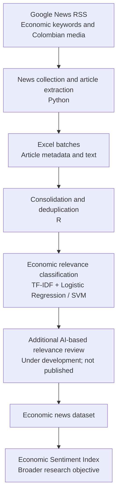

# Colombian Economic News Collection and Classification Pipeline

**AI-assisted research code | Python · R · Google News RSS · Machine Learning**

This project was developed with substantial assistance from generative AI tools to address a practical economic research need: **automating the collection and classification of Colombian news articles as inputs for constructing an Economic Sentiment Index**. AI tools supported code generation, debugging, restructuring, and documentation. The use of AI for software development is distinct from the additional AI-based news classification stage described below.

## Research Objective

The pipeline collects news related to economic activity in Colombia, prepares a consolidated text dataset, and applies supervised classifiers to identify economically relevant articles. The broader research goal is to use these inputs to construct an **Economic Sentiment Index**; the index itself is **not implemented in this public repository**.

## Workflow



## Repository Structure

```text
01_google_news_collection/   Google News RSS collection and article extraction (Python)
02_data_consolidation/       Merge, clean, and prepare collected news (R)
03_news_classification/      Train and apply economic-news classifiers (Python)
```

Each folder contains its own README with stage-specific details.

### 1. Google News Collection — Python

The first stage searches **Google News RSS** using Spanish-language economic keywords and selected Colombian news outlets. It collects article metadata, attempts to resolve links and extract article text, and saves results in **Excel batches** (for example, `google_news_1_DDMMYYYY.xlsx`). These files become the inputs to the R consolidation stage.

The public `google.py` includes only a few **illustrative search terms**. To customize the collection, edit the `KEYWORDS` list in `scrapers/google.py`. The collection period can be set when running `main.py` with `--start-date` and `--end-date` in `YYYY-MM-DD` format; without these arguments, the current version defaults to the current day.

The broader project also includes direct collection from news websites where automated access is permitted, but those website-specific scrapers are **not part of this public release**.

### 2. Data Consolidation — R

The second stage reads the Excel batches, combines them into a single dataset, removes duplicate links and records without article text, and constructs text fields for classification. Where available, a historical news dataset can also be incorporated. The prepared output is `base_texto.xlsx`, which is used in the next stage.

### 3. Economic News Classification — Python

The third stage uses labeled examples to train supervised models that classify articles by **economic relevance**, rather than positive or negative sentiment. It applies text preprocessing and **TF-IDF** features, then estimates:

- **Logistic Regression** with L1 regularization.
- **Support Vector Machine (SVM)** with a linear kernel.

The output, `clasificacion_texto.xlsx`, contains the news records and model predictions (`econ_logit` and `econ_svm`). The scripts can be run in a Python environment such as Spyder; Spyder itself is not a required dependency.

### Additional AI-Based Classification

In the broader workflow, articles selected by the machine learning models undergo an additional **generative-AI-based assessment of economic relevance**. Its prompt and implementation are still being refined and are **not included in this public repository**. This stage should not be confused with the use of generative AI to assist in writing the code.

## Data Availability and Reproducibility

- **Labeled training data:** Cannot be made publicly available. Consequently, full model retraining and reproduction of the reported predictions require access to restricted data.
- **Spanish stopwords:** The preprocessing list is sourced from materials attributed to the **Bank of Spain** and is **available upon request**, subject to access and redistribution permissions.
- **Collected articles:** The repository does not distribute the underlying news datasets or full copyrighted article texts. Access and use of publisher content must respect applicable restrictions and terms.
- **Configuration:** The public examples use illustrative keywords and local file inputs. Users must configure their own collection periods, file paths, and permitted data sources.

## Tools and Methods

**Python:** Requests, Google News RSS, BeautifulSoup, Trafilatura, Pandas, scikit-learn, and NLTK.  
**R:** readxl, dplyr, purrr, and writexl.  
**Methods:** Automated data collection, text extraction, deduplication, text preprocessing, TF-IDF, Logistic Regression, and SVM.

## Project Status

**Ongoing development.** The public code covers Google News collection, data consolidation, and supervised economic-news classification. The additional AI-based review and Economic Sentiment Index are part of the evolving broader research workflow.

## AI Assistance Disclosure

This codebase was developed with **substantial generative AI assistance**, including code generation, debugging, refactoring, and documentation. It is shared to document a research-oriented data pipeline and its implementation choices, not as a claim of unaided software development.
